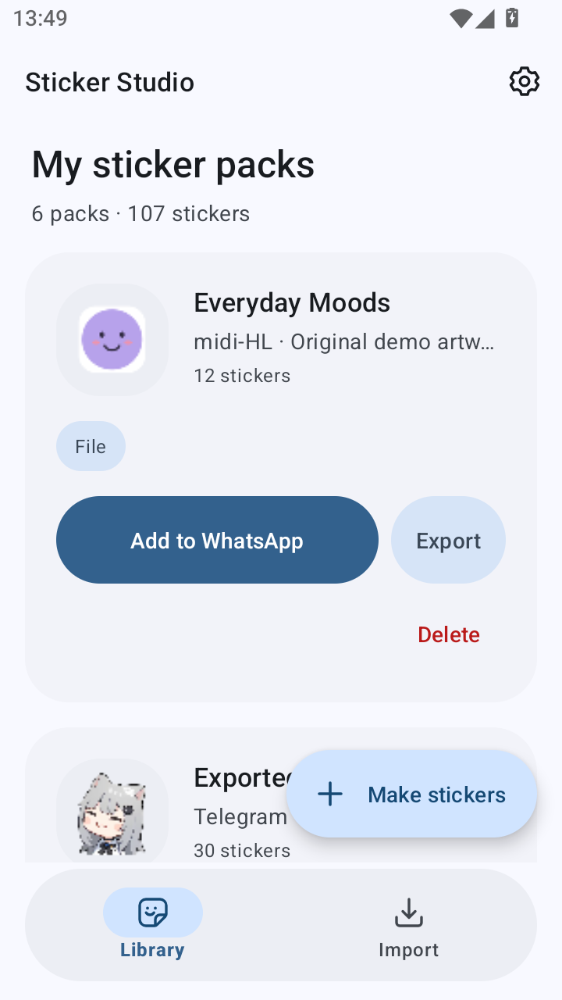
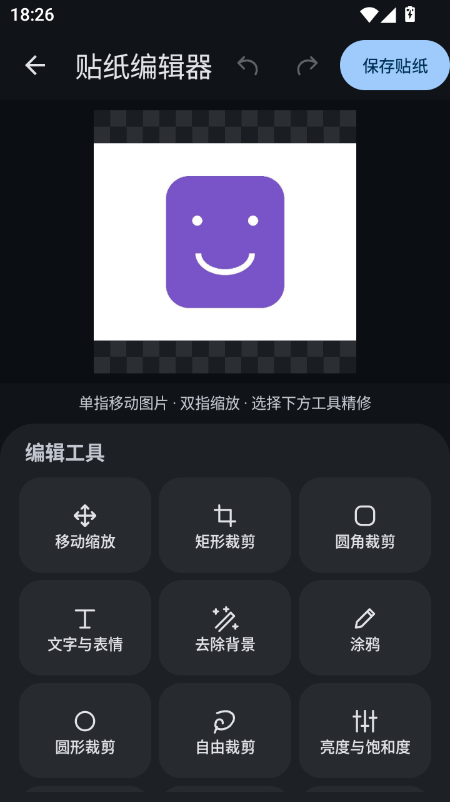
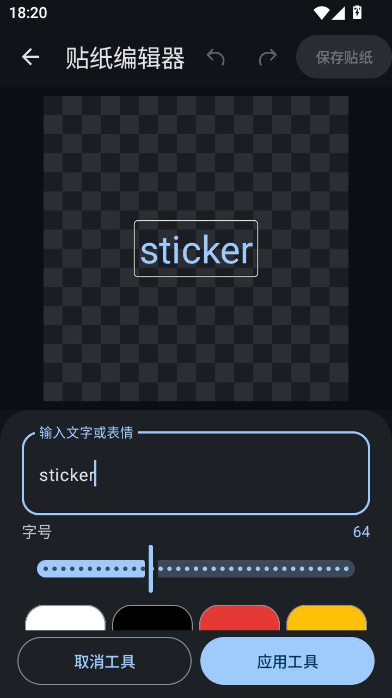
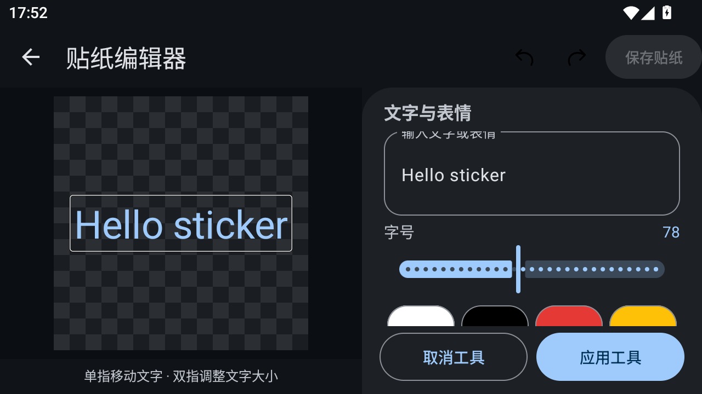
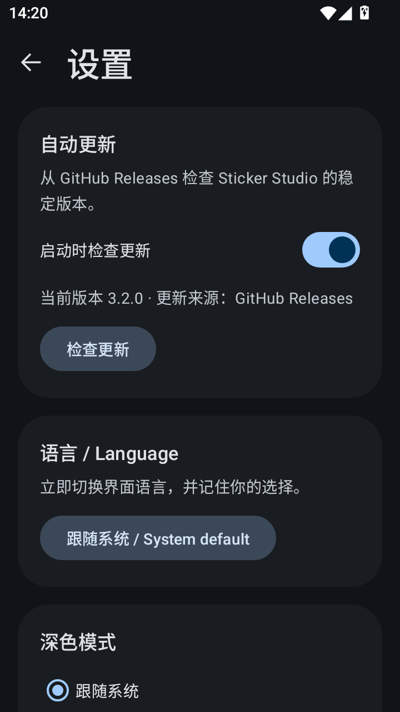

# Sticker Studio

**English** · [简体中文](README.zh-CN.md)

<strong>Make your own stickers. Bring your favorite packs along.</strong>

<a href="https://github.com/midi-HL/wastickers-importer/releases/latest">Download for Android</a> · <a href="https://t.me/sticker_studio_android">Telegram community</a> · <a href="https://github.com/midi-HL/wastickers-importer/issues">Report a problem</a>

Sticker Studio is a free, open-source, ad-free Android app for creating, editing, and organizing sticker packs. Turn pictures, GIFs, and short videos into stickers, import `.wastickers` files, or bring in Telegram sticker packs. Add static packs to WhatsApp, WhatsApp Business, or Telegram, and animated packs to WhatsApp.

**Android 7.0 or later · English and Simplified Chinese · No account required**

## What you can do

- **Create from your own media.** Choose images, GIFs, or a video clip of up to three seconds. Start with a blank canvas for text stickers.
- **Edit with a full set of tools.** Crop into rectangles, rounded shapes, circles, or a freehand selection. Erase and restore areas, remove connected regions of similar color, add text, draw, apply outlines, rotate, mirror, and adjust brightness or saturation. Undo and redo let you revisit recent edits.
- **Move and zoom naturally.** Drag or pinch to position a sticker. Zoom in while using a detail tool to work more precisely.
- **Keep a personal sticker library.** Save drafts, choose covers and emoji, duplicate or reorder stickers, and come back to edit a pack later.
- **Import packs you already have.** Open or share a `.wastickers` file, or paste a Telegram sticker-pack link to download and convert its stickers. Large imported packs are split into smaller packs.
- **Import several Telegram packs at once.** Add each link as a separate task and keep adding links while downloads and conversions run. Follow individual progress, cancel or retry a task, and choose 1–6 shared import threads in Settings (default: 2). Animated conversions also respect available memory.
- **Share across your chat apps.** Add packs through WhatsApp, WhatsApp Business, or Telegram, or export a `.wastickers` file to keep or share.
- **Choose your appearance.** Switch between light, dark, or system appearance, choose a color palette, or use wallpaper colors on supported devices.
- **Stay up to date.** Enable automatic checks for stable GitHub Releases, or check manually in Settings. Open an available APK update in your browser, then confirm installation with Android.

## Screenshots

<table>
  <tr><th>Sticker library</th><th>Image editor</th><th>Text stickers</th></tr>
  <tr>
    <td></td>
    <td></td>
    <td></td>
  </tr>
</table>

The editor also adapts to landscape:

Updates from GitHub Releases, above the language setting:

The app supports both English and Simplified Chinese; these screenshots show examples of both.

## Why Sticker Studio exists

Making a small sticker pack or moving one between chat apps should be straightforward. Sticker Studio brings creation, editing, importing, and exporting into one open-source app, with no ads or account setup. It started as a way to open `.wastickers` files in WhatsApp and has grown into a place to make your own packs, too.

## Get started

Download an APK from [GitHub Releases](https://github.com/midi-HL/wastickers-importer/releases/latest). Most current Android phones use **arm64-v8a**; choose **universal** if you are unsure. When updating from the same release source, install over the existing app to keep your library.

### Make a sticker pack

1. Tap **Make stickers** in the library, then enter a pack name and author.
2. Tap **Add sticker** to choose media or create a text sticker. Static images open in the editor; when importing several, saving one continues to the next.
3. Choose a tool, edit the canvas, then **Apply** or **Cancel** that tool. Tap **Save sticker** when finished.
4. Back in the studio, arrange stickers, assign emoji, and choose a cover. Drafts are kept when you leave.
5. Tap **Save sticker pack**, then add it to a chat app or export it. You can reopen the pack to edit it later.

For GIFs and videos, choose a start time and a clip length of up to three seconds. Static and animated stickers are kept in separate packs.

### Import a `.wastickers` file

1. Open **Import** and choose **Open .wastickers**, or share the file to Sticker Studio from your file manager.
2. Preview the stickers and edit the pack name or author if needed.
3. Tap **Add to WhatsApp** and confirm in WhatsApp. Use the pack's Telegram or export action for other destinations.

### Import a Telegram pack

1. Open [@BotFather](https://t.me/BotFather) in Telegram, send `/newbot`, and follow the prompts to obtain a Bot Token.
2. In Sticker Studio, open **Settings → Telegram Bot Token**, paste the token, and tap **Save and test connection**.
3. Open **Import**, paste a `t.me/addstickers/…` link or the pack's short name, then tap **Add task**. Add more links to import several packs together.
4. Follow each task in the import page. Cancel or retry tasks individually; choose **Settings → Import threads** to adjust concurrency.
5. Open the completed pack from your library. You can add it to WhatsApp, export it, or fetch it again later.

Adding a static pack to the Telegram app does not require a Bot Token. The token is used to download packs through the Telegram import feature.

## WhatsApp requirements

Sticker Studio prepares your stickers for WhatsApp's format requirements.

| Requirement | How the app handles it |
| --- | --- |
| 3–30 stickers per pack | The local library can save 1–30 stickers. Adding to WhatsApp requires at least 3; large imported packs are split and the final group is adjusted. |
| 512 × 512 WebP | Images are resized proportionally and centered on a transparent canvas. |
| Static stickers up to 100 KB | Compression quality is reduced as needed. Images that still exceed the limit are reported. |
| Animated stickers up to 500 KB | Converted animations can use lower quality or frame rates. Complex clips may still exceed the limit. |
| Tray icon up to 96 × 96 and 50 KB | A cover image is generated for the pack. |
| A pack name and author | Empty fields receive defaults; long fields are shortened. |

## Known limitations

- Background removal uses connected similar-color regions and manual tools; it does not perform AI subject segmentation.
- Animated stickers can be imported or created from media, but the detailed canvas editor works with static images. Library thumbnails show the first frame.
- Self-made animated WebP packs are not currently imported directly into Telegram. For an animated pack fetched from Telegram, the Telegram action opens its original pack link.
- Some complex Telegram animations may render differently or fail conversion. Clips that remain over the size limit are reported.
- Keep the app running while fetching a Telegram pack. If Android ends the process, start the fetch again.
- Some file managers do not recognize `.wastickers` files. Use their **Share** action or the app's file picker.
- If WhatsApp displays an older copy after you replace an imported file pack, remove that pack inside WhatsApp and add it again.
- Actual adding, sending, and playback depend on the installed chat app. Device-specific keyboards, launchers, and Android versions can also affect the experience.

## Community

Join [Sticker Studio Android on Telegram](https://t.me/sticker_studio_android) to discuss the app and share feedback. For a reproducible problem or feature request, open a [GitHub issue](https://github.com/midi-HL/wastickers-importer/issues).

## License and credits

Sticker Studio is released under **GPL-3.0-only**. See [LICENSE](LICENSE). Third-party notices and upstream credits are preserved in [NOTICE](NOTICE) and [UPSTREAM-LICENSE-BSD.txt](UPSTREAM-LICENSE-BSD.txt).

Thanks to the WhatsApp Stickers sample, sticker-convert, Telegram's sticker import documentation and sample, and the open-source libraries used by this app.

**Author:** [midi-HL](https://github.com/midi-HL) · **Repository:** [midi-HL/wastickers-importer](https://github.com/midi-HL/wastickers-importer)
