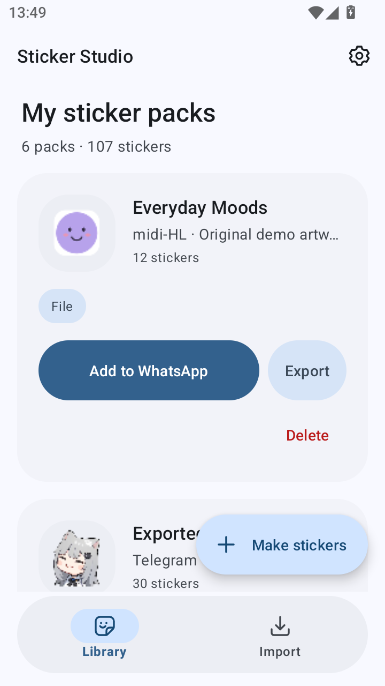
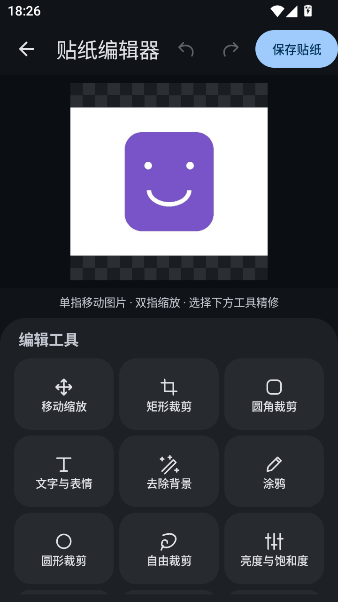
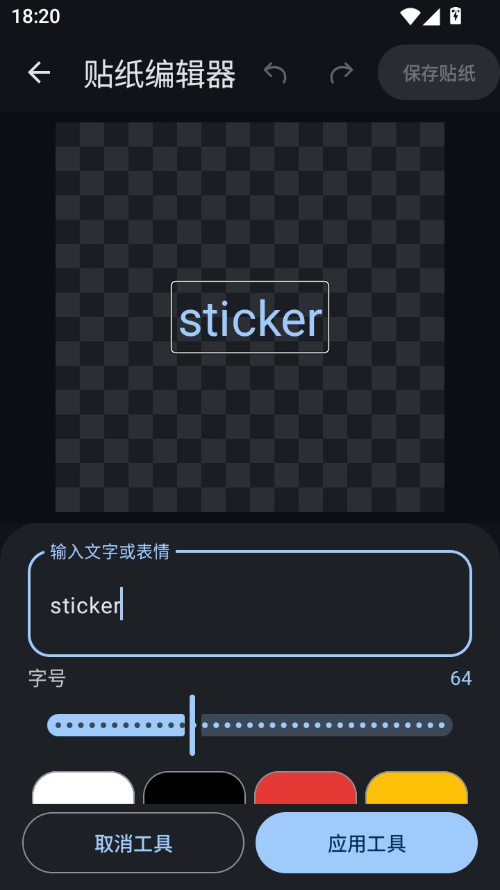
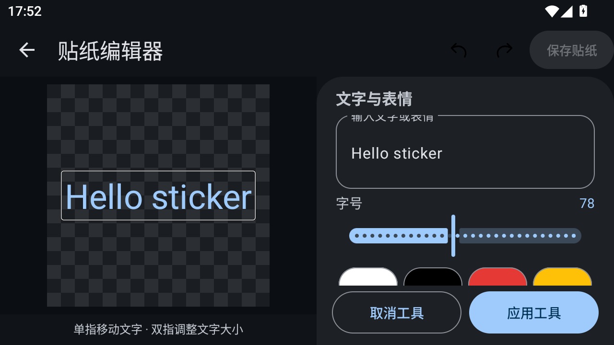
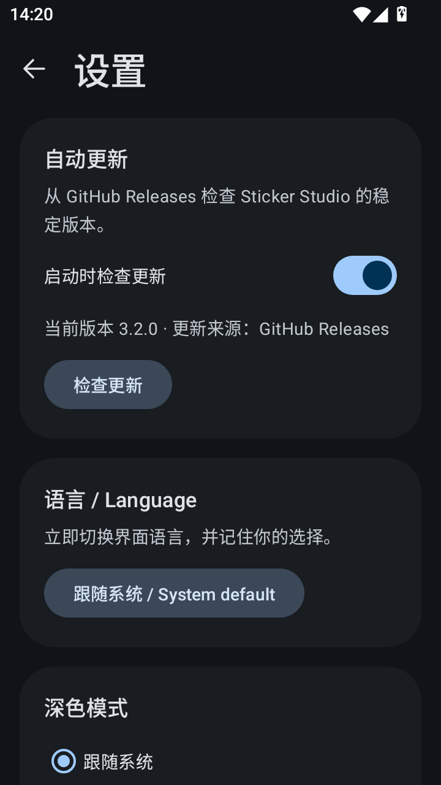

# Sticker Studio

[English](README.md) · **简体中文**

<strong>制作自己的贴纸，也把喜欢的贴纸包带过来。</strong>

<a href="https://github.com/midi-HL/wastickers-importer/releases/latest">下载 Android 版</a> · <a href="https://t.me/sticker_studio_android">Telegram 交流群</a> · <a href="https://github.com/midi-HL/wastickers-importer/issues">反馈问题</a>

Sticker Studio 是一款免费、开源、无广告的 Android 贴纸应用。你可以用图片、GIF 和短视频制作贴纸，导入已有的 `.wastickers` 文件，或拉取 Telegram 贴纸包，在同一个贴纸库里整理和编辑。静态包可添加到 WhatsApp、WhatsApp Business 或 Telegram，动态包可添加到 WhatsApp。

**Android 7.0 及以上 · 支持简体中文和英语 · 无需注册账号**

## 可以做什么

- **用自己的素材制作贴纸。** 选择图片、GIF 或最长三秒的视频片段，也可以从空白画布开始制作纯文字贴纸。
- **使用完整的图片编辑工具。** 矩形、圆角、圆形或自由裁剪，擦除与恢复、连通相似色区域去背景、文字、涂鸦、描边、旋转、镜像、亮度与饱和度调整，还能撤销和重做。
- **拖动、缩放和精修。** 单指拖动、双指缩放来调整贴纸位置；使用精修工具时可放大查看细节。
- **整理自己的贴纸库。** 保留制作草稿，设置封面和表情，复制、排序、删除贴纸，之后也能继续编辑已有贴纸包。
- **导入已有贴纸包。** 打开或分享 `.wastickers` 文件，粘贴 Telegram 贴纸包链接并下载转换；较大的导入包会拆成多个小包。
- **在聊天应用之间分享。** 添加到 WhatsApp、WhatsApp Business 或 Telegram，也可导出 `.wastickers` 文件留存或分享。
- **按喜好调整外观。** 选择浅色、深色或跟随系统，使用内置配色，或在支持的设备上跟随壁纸颜色。
- **及时获取更新。** 开启稳定版 GitHub Release 自动检查，或在设置页手动检查。发现新版后，可在浏览器下载匹配的 APK，再由 Android 确认安装。

## 应用截图

<table>
  <tr><th>贴纸库</th><th>图片编辑</th><th>文字贴纸</th></tr>
  <tr>
    <td></td>
    <td></td>
    <td></td>
  </tr>
</table>

编辑器也支持横屏布局：

设置页顶部可开启自动检查，也可手动检查 GitHub Releases：

应用可切换简体中文和英语，截图展示了两种界面的使用示例。

## 项目动机

做一套小贴纸，或者把喜欢的贴纸包带到另一个聊天应用，应该是一件简单的事。Sticker Studio 希望把制作、编辑、导入和导出集中在一款开源应用里，不需要广告和账号。它最初用于把 `.wastickers` 文件导入 WhatsApp，后来逐渐加入了制作自己贴纸的功能。

## 开始使用

在 [GitHub Releases](https://github.com/midi-HL/wastickers-importer/releases/latest) 下载 APK。多数较新的 Android 手机可选择 **arm64-v8a**；不确定架构时选择 **universal**。更新同一发布来源的版本时，直接覆盖安装即可保留贴纸库。

### 制作自己的贴纸包

1. 在贴纸库点 **制作贴纸**，填写贴纸包名称和作者。
2. 点 **添加贴纸**，选择媒体素材或新建文字贴纸。静态图片会打开编辑器；批量导入时，保存一张后继续下一张。
3. 选择工具并在画布上编辑，完成后点 **应用工具** 或 **取消工具**，最后点 **保存贴纸**。
4. 回到工作室，可排序、关联表情和设置封面。退出后草稿仍会保留。
5. 点 **保存贴纸包**，再添加到聊天应用或导出。已有的贴纸包也能重新打开编辑。

GIF 和视频可指定起点与最长三秒的片段。静态贴纸与动态贴纸分别成包。

### 导入 `.wastickers` 文件

1. 在 **导入** 页面选择 **打开 .wastickers**，或从文件管理器把文件分享到 Sticker Studio。
2. 预览贴纸，按需修改贴纸包名称和作者。
3. 点 **添加到 WhatsApp**，在 WhatsApp 中确认。也可在预览页选择 Telegram 或导出。

### 拉取 Telegram 贴纸包

1. 在 Telegram 打开 [@BotFather](https://t.me/BotFather)，发送 `/newbot`，按提示创建机器人并取得 Bot Token。
2. 在 Sticker Studio 的 **设置 → Telegram Bot Token** 粘贴 Token，点 **保存并测试连接**。
3. 打开 **导入**，粘贴 `t.me/addstickers/…` 链接或贴纸包短名，点 **拉取并转换**。
4. 完成后在贴纸库打开该包，可添加到 WhatsApp、导出或再次拉取。

将静态包添加到 Telegram 应用本身不需要 Bot Token；Token 用于通过 Telegram 导入功能下载贴纸包。

## WhatsApp 限制与处理

Sticker Studio 会按 WhatsApp 的格式要求准备贴纸。

| 要求 | 应用如何处理 |
| --- | --- |
| 每包 3–30 张 | 本地贴纸库可保存 1–30 张；添加到 WhatsApp 时至少需要 3 张。较大的导入包会拆分，并调整最后一组的张数。 |
| 512 × 512 WebP | 图片等比缩放后放到透明画布中央。 |
| 静态贴纸不超过 100 KB | 按需降低压缩质量；仍超限的图片会给出提示。 |
| 动态贴纸不超过 500 KB | 转换时可降低质量或帧率；复杂片段仍可能超限。 |
| 托盘图标不超过 96 × 96 和 50 KB | 为贴纸包生成封面图标。 |
| 贴纸包名称与作者 | 空字段使用默认值，过长字段会被缩短。 |

## 已知限制

- 去背景使用连通相似色区域和手动工具，尚未加入 AI 主体分割。
- 动态贴纸可从媒体导入或制作，画布中的精细编辑针对静态图片；贴纸库缩略图显示首帧。
- 自制动态 WebP 包暂未实现直接导入 Telegram。对于从 Telegram 拉取的动态包，Telegram 按钮会打开原贴纸包链接。
- 某些复杂 Telegram 动画的渲染可能存在差异，或转换失败；压缩后仍超限的片段会给出提示。
- 拉取 Telegram 贴纸时请保持应用运行。若 Android 结束进程，需要重新发起拉取。
- 某些文件管理器不会识别 `.wastickers` 扩展名，请使用 **分享** 或应用内的文件选择器。
- 替换导入文件包后，若 WhatsApp 仍显示旧图，可先在 WhatsApp 内移除该包，再重新添加。
- 实际添加、发送和播放取决于已安装的聊天应用；不同设备的输入法、启动器与 Android 版本也可能影响体验。

## 交流群与反馈

欢迎加入 [Sticker Studio Android Telegram 交流群](https://t.me/sticker_studio_android) 讨论使用体验。可复现的问题和功能建议也可以提交到 [GitHub Issues](https://github.com/midi-HL/wastickers-importer/issues)。

## 许可证与上游署名

Sticker Studio 采用 **GPL-3.0-only** 许可证，完整文本见 [LICENSE](LICENSE)。第三方登记及上游署名保留在 [NOTICE](NOTICE) 和 [UPSTREAM-LICENSE-BSD.txt](UPSTREAM-LICENSE-BSD.txt) 中。

感谢 WhatsApp Stickers 官方示例、sticker-convert、Telegram 贴纸导入文档与示例，以及本应用使用的开源库。

**作者：** [midi-HL](https://github.com/midi-HL) · **开源仓库：** [midi-HL/wastickers-importer](https://github.com/midi-HL/wastickers-importer)
